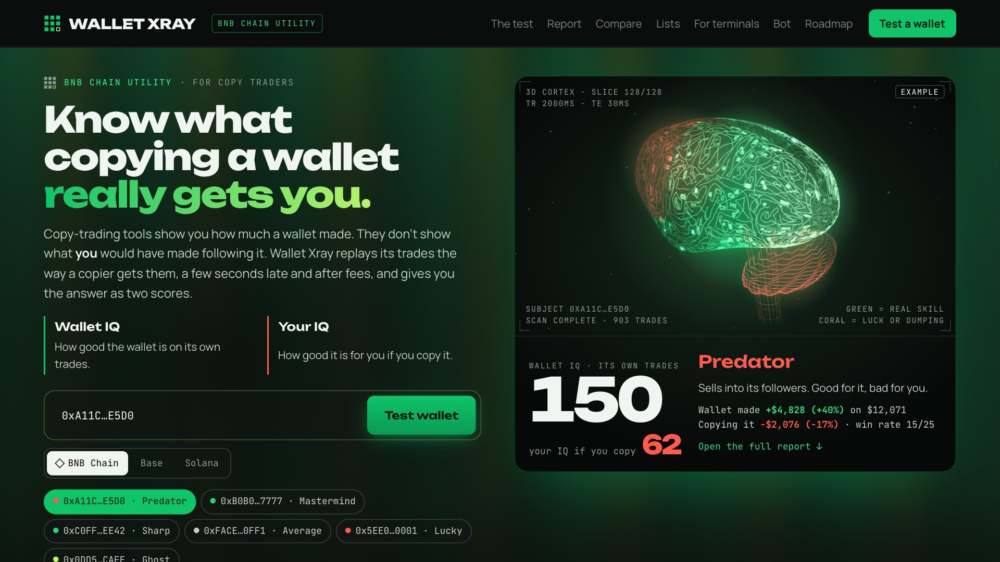

# Wallet Xray

**See what copying a wallet really makes you, not just what it made.**

Copy-trading tools rank wallets by what they earned. A copier never gets those trades: copy bots buy a few seconds later, pay fees on every trade, and some wallets sell straight into the people following them. Wallet Xray replays a wallet's recent trades the way a copier actually gets them and turns the result into two scores.

- **Wallet IQ**: how good the wallet is on its own trades
- **Your IQ**: how good it is for you if you copy it

Live at **[walletxray.xyz](https://walletxray.xyz)** and in Telegram: **[@XRay_Wallet_Bot](https://t.me/XRay_Wallet_Bot)**. Built for BNB Chain (PancakeSwap, four.meme and Flap tokens); also reads Base and Solana.



## How it works

1. **Read** the wallet's recent buys and sells (up to 200 trades, last ~90 days).
2. **Price** each of its 25 largest tokens with 30s, 1m or 5m bars.
3. **Replay** every trade twice, as a copier would get it: a *fast copy* filled 3 seconds later and a *normal copy* filled one bar later, both after a 1% bot fee per side. Sells close the same share of the copier's position. Tokens still held are marked at the last price.
4. **Score** five checks and combine them into the two IQs. See [docs/METHOD.md](docs/METHOD.md).

| Check | Question it answers |
|---|---|
| Speed | Does copying still pay after the delay and fees? |
| Consistency | Is the profit still there without the single best token? |
| Luck | In the worst 5% of 2,000 reshuffles, is it still positive? |
| Memory | Does it still work on the most recent third of its trades? |
| Integrity | Does it sell into rising candles (into its copiers' buys) or flip within 60 seconds? |

Verdicts: **Mastermind**, **Sharp**, **Average**, **Below average**, **Lucky**, **Predator** (good for itself, bad for you: it sells into its followers).

## Repository

```
engine/live.py   copy-replay engine and scoring (same logic as the website)
bot/bot.py       Telegram bot: /iq, /duel, /watch, /masterminds, /predators
bot/card.py      share card and banners (Pillow)
bot/examples.json  example wallets with invented addresses and numbers
docs/METHOD.md   formulas
```

## Run it

Python 3.10+ and Pillow. Market data comes from the GMGN OpenAPI through a small read-only proxy you host (the engine never holds keys and never sends transactions).

```bash
pip install -r requirements.txt
export RELAY_URL=https://your-gmgn-proxy RELAY_TOKEN=your-secret
python3 engine/live.py 0xYourWalletAddress bsc
WIQ_BOT_TOKEN=123:abc python3 bot/bot.py
```

## Safety

- Read-only: no wallet connect, no signatures, no custody, no trading.
- Free use is limited to 15 tests a day per visitor to protect the data source.
- Scores describe past on-chain behaviour. They are **not financial advice** and never tell anyone to buy or sell.

## License

Code: MIT. Fonts in `bot/fonts` (Unbounded, Manrope, JetBrains Mono) are under the SIL Open Font License.
